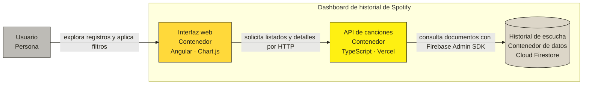
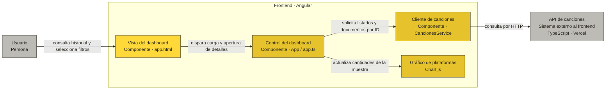

<div align="center">

<a id="inicio"></a>

# 🎧 Spotify History Dashboard

### Explora tu historial de escucha con una arquitectura serverless

**Angular · Vercel · Cloud Firestore**


[🚀 Comenzar](#inicio-rapido) · [🏗️ Arquitectura](#arquitectura) · [🔌 API](#api) · [🛠️ Configuración](#configurar-backend) · [❓ Ayuda](#ayuda)

---

**Consulta reproducciones · Filtra plataformas · Visualiza tendencias de la muestra · Explora detalles**

</div>

## ✨ ¿Qué hace este proyecto?

Este dashboard convierte registros de escucha almacenados en **Cloud Firestore** en una interfaz de consulta desarrollada con **Angular**. Una función serverless en **Vercel** conecta la interfaz con los datos mediante Firebase Admin SDK.

| 🔎 Explorar | 🎛️ Filtrar | 📊 Visualizar | 🧾 Consultar |
| :---: | :---: | :---: | :---: |
| Lista de reproducciones | Plataforma y cantidad | Distribución por plataforma | Detalle por ID de Firestore |

> [!NOTE]
> El proyecto consulta un dataset previamente cargado. No se conecta a la API de Spotify, no reproduce música y no importa automáticamente el CSV.

### Elige por dónde empezar

| Si quieres… | Ve a… |
| --- | --- |
| Ejecutar la interfaz | [Inicio rápido](#inicio-rapido) |
| Comprender los componentes | [Arquitectura](#arquitectura) |
| Probar las consultas | [Explorador de la API](#api) |
| Conectar tu propio Firestore | [Configurar el backend](#configurar-backend) |
| Publicar una instancia | [Despliegue](#despliegue) |
| Resolver un error | [Solución de problemas](#ayuda) |

<a id="inicio-rapido"></a>

## 🚀 Inicio rápido

### 1 · Clona e instala

```bash
git clone https://github.com/RyukGore/project-serverless.git
cd project-serverless
npm ci
cd front
npm ci
```

### 2 · Inicia la interfaz

Desde `front/`:

```bash
npm start
```

### 3 · Abre el dashboard

**[Abrir localhost:4200 →](http://localhost:4200)**

> [!IMPORTANT]
> Angular consulta por defecto la API remota configurada en el proyecto. Iniciar la interfaz no inicia el backend ni carga datos en Firestore. La disponibilidad de esa API debe comprobarse.

<details>
<summary><strong>📋 Ver requisitos del entorno</strong></summary>

- Git.
- Node.js compatible con Angular y las dependencias del backend.
- npm. El frontend declara `npm@11.11.0`.
- Para ejecutar una API propia: Firebase, Firestore y una cuenta de servicio con permisos de lectura.
- Para desplegar la API: una cuenta de Vercel con acceso al proyecto de destino.

El repositorio no fija una versión de Node.js mediante `engines` o `.nvmrc`. Consulte la [tabla oficial de compatibilidad de Angular](https://angular.dev/reference/versions).

</details>

<a id="arquitectura"></a>

## 🏗️ Arquitectura

### C4 Nivel 2 · Vista de contenedores



### C4 Nivel 3 · Componentes del frontend



<details>
<summary><strong>🧠 Entender el recorrido de una consulta</strong></summary>

1. Angular carga el dashboard y solicita registros mediante `CancionesService`.
2. La función de Vercel recibe los parámetros.
3. Firebase Admin SDK consulta la colección `spotify_history`.
4. La API devuelve documentos y metadatos.
5. Angular presenta la tabla y calcula la distribución por plataforma.
6. Abrir un detalle genera otra solicitud con el ID del documento.

**Las credenciales administrativas se utilizan exclusivamente en el backend.**

</details>

> [!TIP]
> El gráfico se calcula con los registros recibidos en la consulta actual. Si solicitas 20 registros, representa esos 20; no toda la colección.

## 🧰 Tecnologías

| Capa | Tecnología declarada | Función |
| --- | --- | --- |
| Interfaz | Angular `^21.2.0` | Dashboard y formularios |
| Lenguaje del frontend | TypeScript `~5.9.2` | Desarrollo tipado |
| Cliente reactivo | RxJS `~7.8.0` | Manejo de respuestas |
| Visualización | Chart.js `^4.6.1` | Gráfico circular |
| Función serverless | `@vercel/node ^30.0.0` | API HTTP |
| Acceso a datos | Firebase Admin SDK `^14.5.0` | Consultas a Firestore |
| Persistencia | Cloud Firestore | Colección de reproducciones |
| Pruebas del frontend | Vitest `^4.0.8` | Pruebas automatizadas |

Las versiones corresponden a `package.json`. Los archivos de bloqueo registran la resolución de dependencias.

<a id="api"></a>

## 🔌 Explorador de la API

**Ruta de consulta**

```http
GET /api/obtenerCanciones
```

**Dirección configurada en Angular**

```text
https://proyecto-serverless-gamma.vercel.app/api/obtenerCanciones
```

Los enlaces siguientes permiten abrir consultas en el navegador. Su funcionamiento depende de la disponibilidad de la instancia y de sus datos.

| Consulta | Abrir |
| --- | --- |
| Listado predeterminado | [▶ Consultar registros](https://proyecto-serverless-gamma.vercel.app/api/obtenerCanciones) |
| Hasta 50 registros | [▶ Consultar con límite](https://proyecto-serverless-gamma.vercel.app/api/obtenerCanciones?limit=50) |
| Plataforma Windows | [▶ Filtrar Windows](https://proyecto-serverless-gamma.vercel.app/api/obtenerCanciones?limit=20&platform=windows) |
| Plataforma Web Player | [▶ Filtrar Web Player](https://proyecto-serverless-gamma.vercel.app/api/obtenerCanciones?limit=20&platform=web%20player) |

### Parámetros disponibles

| Parámetro | Uso | Predeterminado |
| --- | --- | --- |
| `id` | ID del documento de Firestore | Sin búsqueda por ID |
| `limit` | Máximo de resultados del listado | `20` |
| `platform` | Coincidencia exacta sobre `platform` | Todas las plataformas |

**Si se envía `id`, tiene prioridad sobre los filtros del listado.**

<details>
<summary><strong>📄 Ejemplo: listar registros y revisar la respuesta</strong></summary>

```bash
curl "https://proyecto-serverless-gamma.vercel.app/api/obtenerCanciones?limit=20"
```

Respuesta ilustrativa:

```json
{
  "exito": true,
  "tipo": "listado_general",
  "total": 1,
  "totalRegistros": 100,
  "parametros": {
    "limite": 20,
    "plataforma": "todas"
  },
  "data": [
    {
      "id": "documento-ejemplo",
      "track_name": "Canción de ejemplo",
      "artist_name": "Artista de ejemplo",
      "platform": "windows",
      "ms_played": 180000
    }
  ]
}
```

Los valores del ejemplo no corresponden a resultados verificados de una instancia.

| Campo | Interpretación |
| --- | --- |
| `total` | Documentos recibidos en esta consulta |
| `totalRegistros` | Documentos de toda la colección, incluso al filtrar |
| `parametros` | Límite y plataforma aplicados |
| `data` | Documentos encontrados |

</details>

<details>
<summary><strong>🎛️ Ejemplo: filtrar por plataforma</strong></summary>

```bash
curl "https://proyecto-serverless-gamma.vercel.app/api/obtenerCanciones?limit=50&platform=windows"
```

Para valores con espacios:

```bash
curl "https://proyecto-serverless-gamma.vercel.app/api/obtenerCanciones?limit=20&platform=web%20player"
```

La API aplica una comparación de igualdad. Utilice un valor existente en los datos.

</details>

<details>
<summary><strong>🧾 Ejemplo: consultar un documento por ID</strong></summary>

Sustituya `ID_DEL_DOCUMENTO` por un ID real de Firestore:

```bash
curl "https://proyecto-serverless-gamma.vercel.app/api/obtenerCanciones?id=ID_DEL_DOCUMENTO"
```

Respuesta ilustrativa:

```json
{
  "exito": true,
  "tipo": "busqueda_id",
  "data": {
    "id": "documento-ejemplo",
    "track_name": "Canción de ejemplo",
    "platform": "windows"
  }
}
```

El ID del documento no equivale necesariamente a `spotify_track_uri`.

</details>

<details>
<summary><strong>🚦 Estados HTTP y comportamiento actual</strong></summary>

| Estado | Situación |
| --- | --- |
| `200` | Consulta exitosa o respuesta a `OPTIONS` |
| `404` | Documento solicitado inexistente |
| `500` | Error capturado durante la consulta |

Documento inexistente:

```json
{
  "exito": false,
  "mensaje": "No se encontró ninguna canción con el ID: ID_DEL_DOCUMENTO"
}
```

Consideraciones:

- `limit` se convierte mediante `parseInt(valor, 10)`, sin validación explícita completa ni máximo establecido por la aplicación.
- El listado no define orden temporal ni paginación.
- Los errores capturados pueden incluir información técnica.
- La inicialización de credenciales ocurre fuera del `try/catch` del manejador.
- CORS anuncia `GET, POST, OPTIONS`, pero no existe un rechazo explícito de otros métodos.
- No hay operaciones de creación, actualización o eliminación de canciones.

</details>

<a id="configurar-backend"></a>

## 🛠️ Configurar el backend

### Credenciales de Firebase

La implementación actual carga este archivo desde la raíz del proyecto:

```text
canciones-serverless-firebase-admin.json
```

La ruta utiliza `process.cwd()` y el archivo se lee mediante `require`.

1. Prepare un proyecto Firebase con Firestore.
2. Cargue los documentos en `spotify_history`.
3. Obtenga las credenciales de una cuenta de servicio con permisos adecuados.
4. Coloque el archivo privado en la raíz para el entorno local.

> [!WARNING]
> No incluya credenciales en Git, `front/`, `public/` o recursos descargables. El nombre del archivo está excluido en `.gitignore`.

### Ejecutar una API local

Desde la raíz, como alternativa con Vercel CLI:

```bash
npx vercel dev
```

La herramienta puede solicitar instalación, autenticación y vinculación del proyecto.

Para conectar Angular a esa instancia, cambie `apiUrl` en:

```text
front/src/app/services/canciones.ts
```

Utilice la dirección y el puerto indicados por la CLI.

> [!IMPORTANT]
> La API no lee actualmente credenciales desde variables de entorno. Configurar `FIREBASE_SERVICE_ACCOUNT` por sí solo no sustituye el archivo JSON: primero debe adaptarse la inicialización del backend.

## 🗂️ Mapa del proyecto

```text
project-serverless/
├── api/
│   └── obtenerCanciones.ts        # Función serverless
├── dataset spotify/
│   ├── spotify_history.csv        # Dataset
│   └── spotify_data_dictionary Description.csv
├── front/
│   ├── src/app/
│   │   ├── app.ts                # Filtros, gráfico y detalle
│   │   ├── app.html              # Interfaz
│   │   ├── app.css               # Estilos
│   │   └── services/
│   │       └── canciones.ts      # Cliente HTTP
│   ├── angular.json
│   ├── package.json
│   └── package-lock.json
├── .firebaserc
├── .gitignore
├── firebase.json
├── package.json
├── package-lock.json
└── README.md
```

## 🗃️ Datos

**Colección:** `spotify_history`

<details>
<summary><strong>📚 Abrir diccionario de campos</strong></summary>

| Campo | Descripción |
| --- | --- |
| `spotify_track_uri` | URI de la pista en Spotify |
| `ts` | Fecha y hora de finalización de la reproducción en UTC |
| `platform` | Plataforma utilizada |
| `ms_played` | Tiempo escuchado en milisegundos |
| `track_name` | Nombre de la pista |
| `artist_name` | Artista |
| `album_name` | Álbum |
| `reason_start` | Motivo de inicio |
| `reason_end` | Motivo de finalización |
| `shuffle` | Indicador de reproducción aleatoria |
| `skipped` | Indicador de salto |

La API incorpora el ID del documento y devuelve los campos almacenados. No impone un esquema ni convierte automáticamente los tipos del CSV.

</details>

El repositorio contiene el CSV y su diccionario, pero no incluye un importador automático a Firestore.

<a id="despliegue"></a>

## ☁️ Despliegue

<details>
<summary><strong>▲ Backend en Vercel</strong></summary>

1. Importe el repositorio.
2. Seleccione la raíz como directorio del backend.
3. Resuelva la entrega segura de credenciales.
4. Verifique la colección y los permisos de la cuenta de servicio.
5. Despliegue y compruebe `/api/obtenerCanciones`.
6. Actualice la URL del frontend si cambia el dominio.

El JSON privado está excluido de Git y no estará disponible en una importación normal del repositorio. Para utilizar secretos de entorno debe adaptarse primero la inicialización de Firebase Admin.

</details>

<details>
<summary><strong>🌐 Frontend Angular</strong></summary>

Desde `front/`:

```bash
npm run build
```

Publique la salida generada por Angular en el alojamiento elegido. Configure el fallback a `index.html` cuando corresponda.

El repositorio no contiene una configuración específica de hosting del frontend.

</details>

<details>
<summary><strong>🔥 Sobre el archivo firebase.json</strong></summary>

La configuración declara una fuente de funciones llamada `functions`, pero esa carpeta no existe en el repositorio.

La función implementada está en `api/obtenerCanciones.ts` y utiliza tipos de Vercel. La configuración Firebase existente no constituye un procedimiento completo de despliegue para esta API.

</details>

## 🧪 Pruebas y validación

Desde `front/`:

```bash
# Compilar
npm run build

# Ejecutar las pruebas existentes sin modo de observación
npm test -- --watch=false
```

> [!NOTE]
> Los comandos corresponden a las herramientas declaradas. Este README no certifica que la compilación o las pruebas hayan pasado.

En la raíz, `npm test` es un marcador que termina con `Error: no test specified`. No existe una suite automatizada de backend.

<details>
<summary><strong>✅ Lista de comprobación funcional</strong></summary>

- [ ] La interfaz carga registros.
- [ ] El límite modifica la cantidad solicitada.
- [ ] El filtro utiliza una plataforma existente.
- [ ] El detalle corresponde al ID seleccionado.
- [ ] Un ID inexistente devuelve `404`.
- [ ] `totalRegistros` coincide con el conteo de la colección.
- [ ] El gráfico representa el listado recibido.

Esta lista es una guía de validación, no evidencia de pruebas ejecutadas.

</details>

## 🔐 Seguridad y límites actuales

| Control | Estado en el código |
| --- | --- |
| Autenticación y autorización | No implementadas en la API |
| CORS | Permite cualquier origen con `*` |
| Credenciales | Archivo JSON en el backend |
| Validación de parámetros | Sin validación explícita completa |
| Rate limiting | No implementado |
| Paginación | No implementada |
| Datos devueltos | Campos completos del documento |
| Errores | Pueden exponer mensajes técnicos |

<details>
<summary><strong>🛡️ Recomendaciones antes de publicar datos reales</strong></summary>

- Configure permisos IAM mínimos para la cuenta de servicio.
- Use un mecanismo seguro de entrega de credenciales.
- Evalúe autenticación y autorización según la audiencia.
- Valide parámetros y establezca un máximo de resultados.
- Revise privacidad y campos publicados.
- Evite devolver detalles internos en errores públicos.
- Evalúe cuotas y costos: cada listado consulta documentos y realiza un conteo global.

Firebase Admin utiliza la identidad de la cuenta de servicio y no las reglas de acceso de clientes de Firestore.

CORS no sustituye la autenticación. `.gitignore` tampoco elimina secretos previamente versionados; una clave expuesta debe revocarse y reemplazarse.

</details>

<a id="ayuda"></a>

## ❓ Solución de problemas

<details>
<summary><strong>La API no encuentra las credenciales</strong></summary>

Revise el nombre `canciones-serverless-firebase-admin.json`, su ubicación respecto a `process.cwd()` y el mecanismo de entrega del archivo al entorno.

</details>

<details>
<summary><strong>Firestore rechaza la consulta</strong></summary>

Compruebe el proyecto de la cuenta de servicio, los permisos IAM y el acceso a la base de datos.

</details>

<details>
<summary><strong>El listado está vacío</strong></summary>

Verifique que existan documentos en `spotify_history` y que `platform` coincida exactamente con un valor almacenado.

</details>

<details>
<summary><strong>El total no cambia al aplicar filtros</strong></summary>

`totalRegistros` cuenta toda la colección. `total` indica cuántos documentos recibió la consulta actual.

</details>

<details>
<summary><strong>El gráfico no representa todo el historial</strong></summary>

El gráfico se calcula en Angular con los documentos del listado recibido. Su alcance depende del límite y de la plataforma seleccionada.

</details>

<details>
<summary><strong>Angular consulta una instancia diferente</strong></summary>

Revise `apiUrl` en `front/src/app/services/canciones.ts`.

</details>

<details>
<summary><strong>El despliegue de Firebase busca functions/</strong></summary>

La configuración Firebase existente apunta a una carpeta ausente. La función actual se encuentra en `api/` y está implementada para Vercel.

</details>

## 🤝 Contribuciones

1. Cree una rama con un nombre descriptivo.
2. Realice cambios acotados al objetivo.
3. Actualice la documentación cuando cambie el comportamiento.
4. Ejecute las verificaciones correspondientes.
5. Abra un pull request con la descripción del cambio y su validación.

No incluya credenciales ni información sensible.

## 📄 Licencia y procedencia de los datos

El `package.json` de la raíz declara `ISC`, pero el repositorio no contiene un archivo `LICENSE` con sus condiciones. El frontend está marcado como privado para npm.

La página de descarga y la licencia del dataset no están identificadas en los archivos revisados. Confirme su procedencia y condiciones antes de redistribuirlo.

El nombre Spotify describe los datos utilizados y no implica una integración oficial.

---

<div align="center">

**Angular para explorar · Vercel para consultar · Firestore para almacenar**

[⬆ Volver al inicio](#inicio)

</div>
